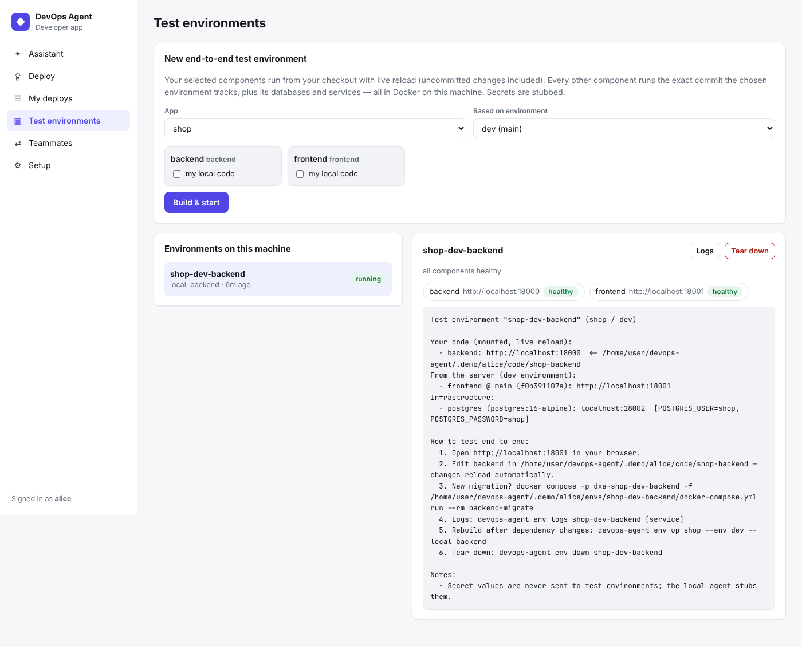
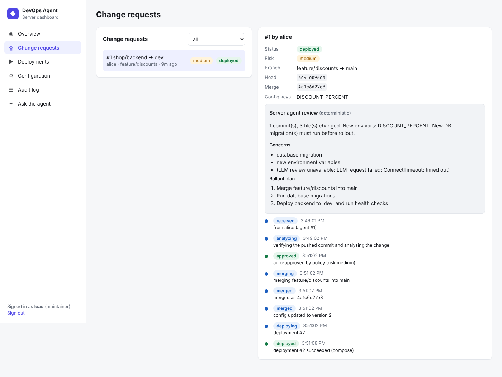

# DevOps Agent

A fleet of agents that deploys developers' work and builds realistic end‑to‑end test environments on demand.

* **One server agent** merges pushed branches into environment branches, owns each environment's configuration,
  runs deployments, and brokers requests between developers. It reasons with a **vLLM‑hosted Qwen3.8‑27B**.
* **One local agent per developer** runs next to the code with a small **local model (Ornith‑1.5‑9B on CPU via
  Ollama)**. It works out what a pushed branch changes (configs, dependencies, migrations), asks the server agent to
  deploy it, and spins up Docker test environments: *your* component from your checkout with live reload, every
  other component at the exact commit the environment runs.

```text
 developer laptop                                          server
┌──────────────────────────────────────┐        ┌───────────────────────────────────────┐
│ Developer app (React) ─┐             │        │ Server agent (FastAPI)  ── PostgreSQL │
│ devops-agent CLI ──────┼─ Local agent │ HTTPS  │   pipeline · config store · deployer  │
│ Ornith-1.5-9B (Ollama) ┘  (FastAPI)  ├───────►│   peer broker · audit · dashboard     │
│ your checkouts  (read-only to agent) │        │ vLLM: Qwen3.8-27B-AWQ                 │
│ Docker: test environments            │        │ Docker Compose deployments            │
└──────────────┬───────────────────────┘        └───────────────┬───────────────────────┘
               │ git push (developer only)                       │ fetch / merge --no-ff / push
               └──────────────────────────► Git hosting ◄────────┘
```

| Developer app — test environments | Server dashboard — change request |
|---|---|
|  |  |

## The rules, enforced in code

| Rule | How |
|---|---|
| Local agents **never commit or push** — developers do | `ReadOnlyGit` allow‑list; anything else raises before git runs |
| Server agent **merges but never changes code** | `MergeGit`: `merge --no-ff` only, no conflict resolution, push only `HEAD:refs/heads/<env-branch>`; every merge is verified to contain only the developer's changes |
| Server agent **updates configs** | versioned, encrypted per‑environment config store (not files in repos) |
| The server never trusts the laptop | it re‑fetches, checks the commit is pushed, re‑runs the analysis and compares; any mismatch → human review |
| LLMs advise, policy decides | LLM review can raise risk, never lower it; prod / high risk / missing config → maintainer approval (not the requester) |
| Secrets never reach laptops | test‑env specs carry secret *keys* only; local values come from manifests or placeholders |

Details: [docs/SECURITY.md](docs/SECURITY.md).

## How it works

**Deploy:** push your branch → *"deploy feature/payments to staging"* → the local agent runs preflight (is it pushed?
unpushed commits? uncommitted work?) and analyses `origin/main..origin/feature/payments`: new env vars (Python
`os.environ`/`getenv`, pydantic `BaseSettings`, JS `process.env`/`import.meta.env`, `.env.example`, Dockerfile),
config files, dependencies, Alembic migrations, committed secrets. It asks you for new config values and sends a
deploy request. The server agent verifies, re‑analyses, reviews (vLLM), applies policy, merges, updates the config
store and deploys — and tells your agent the outcome (or the conflict and how to fix it).

**Test end to end:** *"set up an e2e env for my backend against dev"* → the local agent fetches the dev environment
spec from the server, mounts your backend checkout (hot reload, uncommitted changes included), exports the frontend
at the commit dev runs, adds Postgres and other services, resolves URLs between them, starts it all with Docker
Compose, waits for health checks and tells you exactly how to test.

**Developer‑to‑developer (phase 2 preview):** *"get Bob's frontend branch"* → Bob's agent asks him; on approval it
shares a git bundle (or his working tree) via the server; your test environment uses his code.

Full flows and diagrams: [docs/ARCHITECTURE.md](docs/ARCHITECTURE.md).

## Quick start (everything on one machine)

Requirements: Docker with Compose v2, git, [uv](https://docs.astral.sh/uv/), Node 22, curl, jq.

```bash
scripts/demo.sh
```

It starts Postgres and the server agent, creates two git remotes from [`examples/shop`](examples/shop) (FastAPI +
SQLAlchemy + Alembic backend, React frontend), deploys a baseline with Docker Compose, then plays developer *alice*:
she pushes a change with a new setting and a migration, her agent gets it reviewed, merged, configured and deployed,
and she builds a local end‑to‑end test environment. At the end it prints the dashboard URL and token. Clean up with:

```bash
scripts/demo.sh down
```

To point the server agent at your vLLM, export `VLLM_BASE_URL`, `VLLM_API_KEY` and `VLLM_MODEL` before running the
demo (or the server) and verify with `uv run devops-server check-llm`.

## Using it for real

**Server (once per team)**

```bash
cp deploy/.env.example deploy/.env      # Postgres password, DEVOPS_SECRET_KEY, admin token, VLLM_*
docker compose -f deploy/docker-compose.yml --env-file deploy/.env up -d --build
# dashboard: http://<server>:8080   API docs: http://<server>:8080/docs
docker compose -f deploy/docker-compose.yml exec server devops-server create-user alice --role developer
docker compose -f deploy/docker-compose.yml exec server devops-server check-llm
```

Register apps in the dashboard or via the API: create the app with its environments (`dev → develop`,
`prod → main, requires approval`, …), then import each repo's components from its
[`devops-agent.yaml`](docs/MANIFEST_SPEC.md) (`POST /apps/{app}/components/import`). Give the server git
credentials that can push the environment branches.

**Each developer**

```bash
uv tool install ./local_agent                     # or: uv sync --all-packages && uv run devops-agent ...
(cd web && npm ci && npm run build) && mkdir -p ~/.devops-agent && cp -r web/dist ~/.devops-agent/ui   # UI for the daemon
devops-agent setup --server https://devops.example.com --token <your token> --pull-model
devops-agent link shop/backend ~/code/shop-backend
devops-agent daemon                               # developer app → http://127.0.0.1:7600
```

Or stay in the terminal:

```bash
devops-agent init --write                              # draft devops-agent.yaml for a repo (review + commit it)
devops-agent analyze --env dev                         # what does my pushed branch change?
devops-agent deploy --env dev --set FEATURE_X=on       # ask the server agent to merge + deploy
devops-agent env up shop --env dev --local backend     # e2e test env with my backend
devops-agent env logs shop-dev-backend backend
devops-agent peer request shop/frontend --from bob --branch feature/new-ui
devops-agent chat "set up a test env for my frontend against staging"
```

## Local model

Developer laptops have **20 GB RAM, CPU only, 512 GB disk**. After comparing Gemma 4 (E2B/E4B/12B/26B‑A4B/31B),
Meta Muse Glimmer 30B, Ornith 1.5 (9B/35B‑A3B), Qwen3.5/3.6/3.8, gpt‑oss‑20b and Phi‑4‑mini, the default is
**Ornith‑1.5‑9B Q4_K_M** (~5.6 GB file, ~7.5 GB RAM at 16K context, MIT, built for agentic coding), with
**Gemma 4 E4B** as the low‑memory fallback and **Gemma 4 12B** as an opt‑in. Muse Glimmer 30B (~17 GB at Q4, ~1.6
tok/s on a 4‑core CPU) and the 35B MoEs (~22 GB) don't leave room for the IDE, browser and Docker. The agent is
deterministic‑first, so it remains fully usable (UI, CLI, rule‑based chat) even without the model. Full analysis:
[docs/research/LOCAL_MODEL_SELECTION.md](docs/research/LOCAL_MODEL_SELECTION.md).

## Repository layout

| Path | Contents |
|---|---|
| [`packages/common`](packages/common/devops_common) | shared protocol, manifest spec, git capability guards, change analyzer, compose renderer, LLM client |
| [`server`](server/devops_server) | server agent: API, pipeline, config store, deployer, peer broker, Alembic migrations, `devops-server` CLI |
| [`local_agent`](local_agent/devops_local) | local agent: `devops-agent` CLI, localhost daemon, environment builder, model manager, SLM brain |
| [`web`](web/src) | React + TypeScript UI: developer app and server dashboard |
| [`examples/shop`](examples/shop) | sample app used by the demo |
| [`deploy`](deploy) | Dockerfile and Compose stack for the server agent |
| [`scripts`](scripts) | `demo.sh`, `export_openapi.py` |
| [`docs`](docs) | plan, architecture, security, API, manifest spec, LLM, testing, decisions, research |

## Documentation

| Document | What's in it |
|---|---|
| [PLAN.md](docs/PLAN.md) | requirements traceability, assumptions, phases/roadmap, **open questions**, risks |
| [ARCHITECTURE.md](docs/ARCHITECTURE.md) | components, sequence diagrams for deploy / test env / peer flows, data model |
| [SECURITY.md](docs/SECURITY.md) | every guardrail, where it is enforced and which test proves it; threat model |
| [MANIFEST_SPEC.md](docs/MANIFEST_SPEC.md) | `devops-agent.yaml` reference, templates, how config changes are detected |
| [API.md](docs/API.md) | server REST API, local daemon API, CLI reference ([OpenAPI JSON](docs/openapi/)) |
| [SERVER_LLM.md](docs/SERVER_LLM.md) | vLLM configuration, `check-llm`, prompts, guardrails, fallback |
| [research/LOCAL_MODEL_SELECTION.md](docs/research/LOCAL_MODEL_SELECTION.md) | local model research and decision |
| [DEVELOPMENT.md](docs/DEVELOPMENT.md) | running each part, tests, migrations, UI dev, proxies |
| [TESTING.md](docs/TESTING.md) | test coverage, e2e verification, local model acceptance test |
| [DECISIONS.md](docs/DECISIONS.md) | architecture decision records |

## Tech stack

Python 3.11 · FastAPI · SQLAlchemy 2 · PostgreSQL 16 · Alembic · Pydantic v2 · uv workspace · React 19 +
TypeScript + Vite · Docker Compose · vLLM (Qwen3.8‑27B AWQ) · Ollama (Ornith‑1.5‑9B GGUF).

## Development

```bash
uv sync --all-packages
uv run ruff check . && uv run pytest          # 70 tests: shared lib, server pipeline, local agent
(cd web && npm install && npm run build)
```

See [docs/DEVELOPMENT.md](docs/DEVELOPMENT.md).

## Status

Phase 1 (deploy flow, test environments, server dashboard, developer app, model management) is implemented and
verified end to end with real Docker deployments; developer‑to‑developer sharing is a working preview. Next steps
and the questions that shape them are in [docs/PLAN.md](docs/PLAN.md). The vLLM endpoint could not be reached from
the environment this was built in — run `devops-server check-llm` to validate it.
