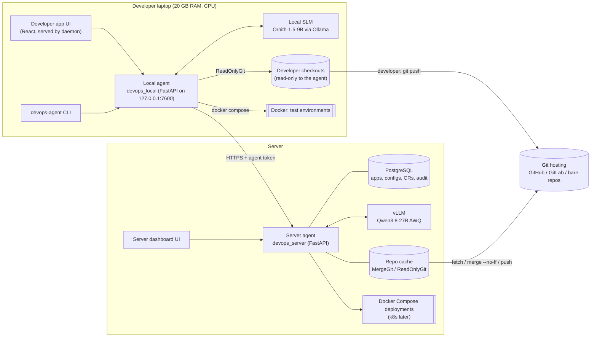
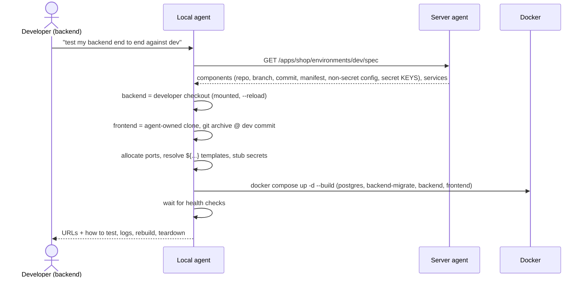
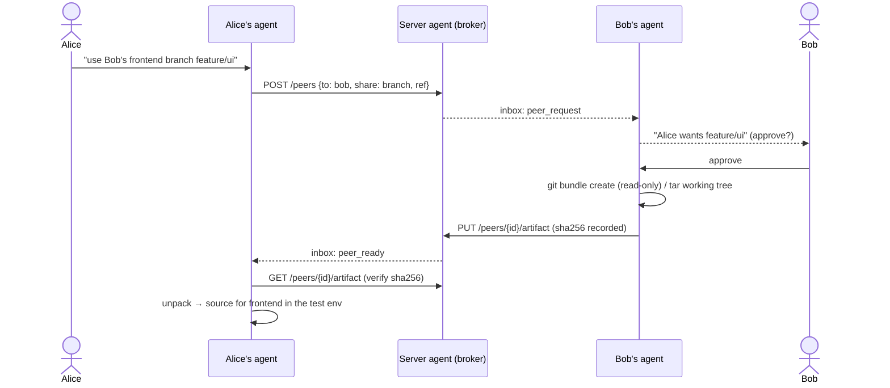

# Architecture

DevOps Agent is a small fleet of agents:

* **one server agent** (central) — owns merges into environment branches, environment configuration and
  deployments, and is the broker between developers;
* **one local agent per developer** — runs on the laptop next to the code, with a small local model; it
  inspects what the developer pushed, asks the server agent to deploy it, and builds Docker test
  environments for end‑to‑end testing.



## Repository layout

| Path | What |
|---|---|
| `packages/common/devops_common` | Shared library: wire protocol, manifest spec, **git capability guards**, change analyzer, compose renderer, LLM client, tool loop |
| `server/devops_server` | Server agent: REST API, pipeline orchestrator, config store, deployer, peer broker, Alembic migrations |
| `local_agent/devops_local` | Local agent: CLI, localhost daemon, environment builder, model manager, SLM "brain" |
| `web/` | React + TypeScript UI. One bundle, two modes: *developer app* (served by the local daemon) and *server dashboard* (served by the server) |
| `examples/shop` | Sample multi‑repo app (React frontend, FastAPI + SQLAlchemy + Alembic backend, Postgres) used by the demo |
| `deploy/` | Docker Compose for running the server agent stack |
| `scripts/demo.sh` | End‑to‑end demo on one machine |

## Core principles

1. **Capabilities enforced in code, not prompts.** Git access goes through `devops_common.gitguard`:
   `ReadOnlyGit` (local agent on developer repos), `WorkspaceGit` (agent‑owned clones), `MergeGit` (server).
   Disallowed operations raise `GitPolicyError` before a process is spawned. See [SECURITY.md](SECURITY.md).
2. **Deterministic first, LLM‑assisted.** Facts (what changed, which env vars, which migrations) come from a
   deterministic analyzer that both agents run. LLMs summarise, review, explain and route natural language.
   The LLM can *raise* risk but never lower the deterministic floor, and never approves anything.
3. **Trust but verify.** The server never trusts the laptop: it re‑fetches, checks the commit is really on the
   pushed branch, re‑runs the analysis and compares fingerprints. Disagreement ⇒ human review.
4. **Config lives in the server, not in repos.** A versioned, encrypted config store per environment means the
   server agent can "update configs" without ever writing to application code.
5. **Secrets never reach laptops.** Test‑environment specs list secret *keys* only; the local agent stubs them.
6. **Humans confirm outward actions.** The local SLM proposes deploys/peer requests; the developer confirms.
   Production and high‑risk changes need a maintainer's approval (not the requester's).

## Components

### Shared library (`devops_common`)

| Module | Responsibility |
|---|---|
| `protocol` | Pydantic models exchanged between agents: `ChangeReport`, `DeployRequest`, `ChangeRequestView`, `EnvironmentSpec`, `PeerRequest*`, `InboxEvent` |
| `manifest` | `devops-agent.yaml` spec ([MANIFEST_SPEC.md](MANIFEST_SPEC.md)) + **inference** from repo structure (FastAPI/Flask/React/Angular/Vite, SQLAlchemy/Alembic → Postgres service) |
| `gitguard` | Allow‑listed git subcommands/flags per capability; `MergeGit.merge_verified()` proves the merge only contains the developer's changes |
| `analysis` | `analyze_branch()` — env vars (Python `os.environ/getenv`, pydantic `BaseSettings` via AST, JS `process.env`/`import.meta.env`, Dockerfile `ENV/ARG`, `.env.example`), config files, dependency files, migrations, build files, committed‑secret detection |
| `compose` | Pure renderer: `EnvironmentSpec` + sources → Compose document. Templates like `${components.backend.external_url}`, `${services.postgres.host}`; inline Dockerfiles for repos without one; migration one‑shot services |
| `llm` | OpenAI‑compatible client for vLLM / Ollama / llama.cpp; strips `<think>`, parses text tool calls, JSON‑schema outputs with one repair attempt |
| `agentloop` | Bounded tool‑calling loop; mutating tools can require confirmation |

### Server agent (`devops_server`)

* **API** (`/api/v1`): users/tokens, agent registration & inbox, apps/components/environments, configs,
  change requests, deployments, environment specs, peers, audit, operator chat. See [API.md](API.md).
* **Orchestrator** (`services/orchestrator.py`) — the change‑request pipeline (below).
* **Config store** (`services/config_store.py`) — per‑environment key/values scoped app‑wide (`*`) or per
  component; every change bumps `config_version` and writes a masked `ConfigRevision`; secrets Fernet‑encrypted.
* **Deployer** (`services/deployer.py`) — `compose` target (export merged commit with `git archive`, render
  Compose with config + secrets, `docker compose up -d --build --wait`) and `dry_run` target. Plans are stored
  with secrets masked. Failures get an LLM diagnosis.
* **LLM service** (`services/llm_service.py`) — vLLM client; review, conflict explanation, failure diagnosis,
  operator chat with *read‑only* tools. See [SERVER_LLM.md](SERVER_LLM.md).
* **Peer broker** (`services/peers.py`) — consent‑gated, expiring artifact relay between developers.
* **Jobs** — background thread pool; all state in Postgres. Swap for a queue for multi‑replica setups.

### Local agent (`devops_local`)

* **CLI** `devops-agent` and **daemon** (127.0.0.1:7600, CSRF guard) share one `LocalAgent` facade.
* **Preflight** — branch pushed? local commits not pushed? uncommitted changes? (warn, never fix).
* **Environment builder** — spec → sources (local mount / agent‑owned clone at the exact commit / peer share)
  → ports → Compose → `up` → health checks → instructions.
* **Brain** — SLM tool loop over 7 compact tools, confirmation for outward actions, rule‑based fallback.
* **Model manager** — hardware detection, catalog recommendation, Ollama pull + tuned alias.

## Flow 1 — "deploy my changes"

```mermaid
sequenceDiagram
  actor Dev as Developer
  participant LA as Local agent
  participant G as Git remote
  participant SA as Server agent
  participant L as vLLM
  actor M as Maintainer
  Dev->>G: git push origin feature/x (developer only)
  Dev->>LA: "deploy feature/x to dev"
  LA->>G: git fetch (read-only)
  LA->>LA: preflight + analyze_branch(origin/main..origin/feature/x)
  LA->>Dev: new env vars / migrations / deps — ask for config values
  Dev->>LA: values (+ confirm)
  LA->>SA: POST /change-requests {report, head_sha, config_values}
  SA->>G: fetch; verify head_sha ∈ origin/feature/x
  SA->>SA: re-run analyze_branch, compare with local report
  SA->>L: review(facts) → risk, concerns, rollout steps
  SA->>SA: policy: risk floor, prod?, missing config?, discrepancies?
  alt needs a human
    SA-->>M: awaiting_approval (dashboard)
    M->>SA: approve (cannot be the requester)
  end
  SA->>G: merge --no-ff (verified: only developer's paths) + push
  SA->>SA: apply config values → config_version+1
  SA->>SA: deploy (compose) with merged commit + config
  SA-->>LA: inbox: deployed / conflict / failed (+ explanation)
```

Statuses: `received → analyzing → (awaiting_approval) → approved → merging → merged → deploying → deployed`,
or `rejected | conflict | failed`. Every transition is appended to the request's timeline and the audit log.

**Conflicts** are never resolved by the server: the request goes to `conflict`, and the developer gets the
conflicting files plus (LLM‑written) instructions to merge the target branch locally and push again.

## Flow 2 — "set up an end‑to‑end test environment"



The developer's component runs from their working copy *including uncommitted changes*; all other components
run the exact commit the environment tracks, so the developer tests against what is really deployed.

## Flow 3 — developer‑to‑developer (phase 2 preview)



## Data model (PostgreSQL)

| Table | Purpose |
|---|---|
| `users`, `api_tokens` | identities (developer / maintainer / admin), hashed tokens (user and per‑agent) |
| `agents` | registered local agents, model, capabilities, last seen |
| `apps`, `components`, `environments` | topology: repos, sub‑paths, cached manifests; env branch, overrides, approval, auto‑deploy, deploy target |
| `config_entries`, `config_revisions` | current config (scope, key, encrypted value) and masked history per version |
| `change_requests` | deploy requests: both reports, discrepancies, review, risk, proposed config (secrets encrypted), timeline |
| `deployments` | executions: target, component SHAs, config version, masked plan, log, LLM diagnosis |
| `audit_events` | append‑only log of every agent action and human decision |
| `inbox_events` | notifications for local agents (polled) |
| `peer_requests` | consent‑gated peer shares with artifact checksum and expiry |

Migrations: Alembic (`server/alembic`), `devops-server migrate`.

## Deployment of the system itself

* **Server agent**: container (`deploy/server.Dockerfile`) + Postgres (`deploy/docker-compose.yml`), with the
  Docker socket mounted for the `compose` deploy target, env vars for vLLM and secrets.
* **Local agent**: `uv tool install` / pip package today; later wrapped as a desktop app (Tauri/Electron shell
  around the same daemon + UI — see [PLAN.md](PLAN.md)). The model runtime (Ollama) is a separate install.
